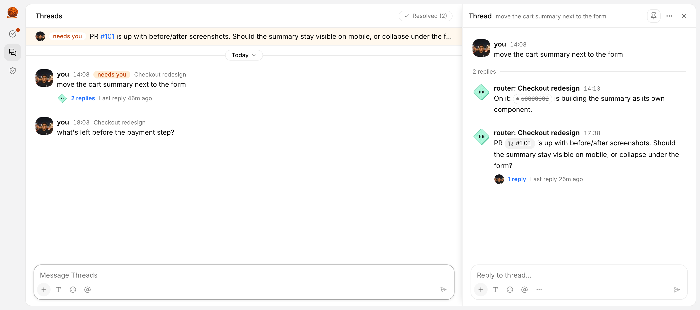
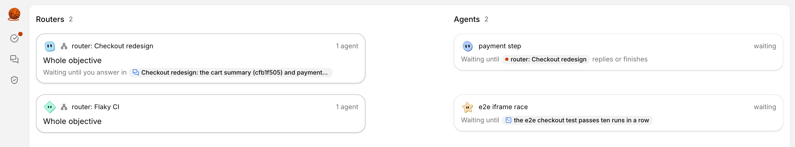
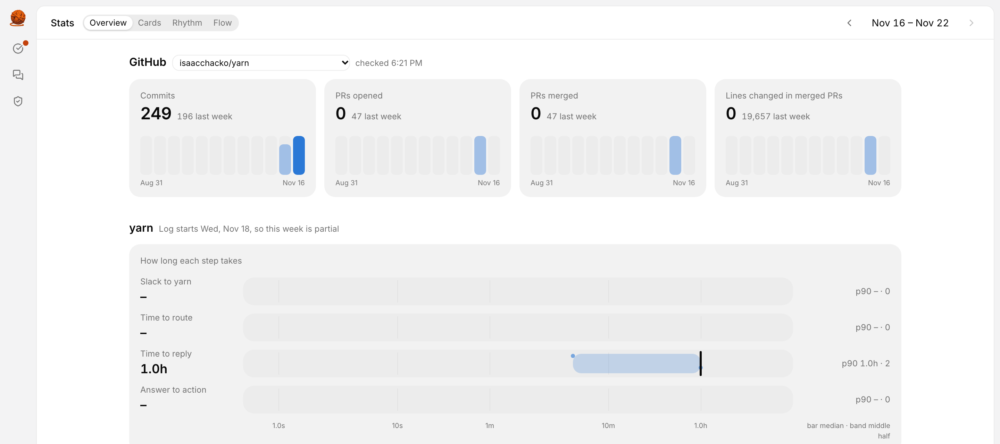

# yarn

yarn is the place I work from. It's a web terminal on my laptop where Claude Code agents do the work, and I read threads instead of watching terminals.

I type what I want into a thread. An agent picks it up, starts other agents if the job needs them, and writes back in that thread when it's done or when it needs me to decide something.



It's a hobby project, and nobody else is meant to run it as is. I built it for how I work, and I change it whenever it gets in my way. Most of it was written by the agents running inside it.

I think this is where software is heading. When a tool costs an afternoon of asking for it, everyone ends up with software made for exactly them. yarn is my step toward that.

## A few things in it

Every agent sits under the router that briefed it, so I can see who's working on what.



An agent waiting on something says so in a sentence, and the sentence is a link to the thing it's waiting on.


A Stats page tracks my week: commits, PRs, and how long each step takes.



The screenshots come from a demo instance with made-up data (`./dev.sh --seed`).

## Running it

It runs on Bun and tmux, on macOS or Linux. The current code is on the `feat/v2` branch.

```sh
bun install
./dev.sh --seed      # a demo instance with sample threads, on http://localhost:4948
```

[docs/reference.md](docs/reference.md) covers the rest: the CLI, the sentries, and how agents are wired together.
